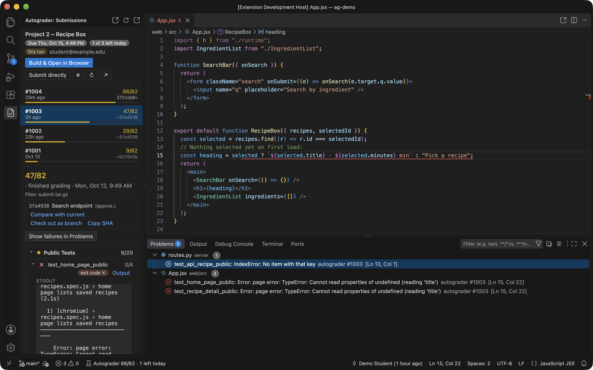
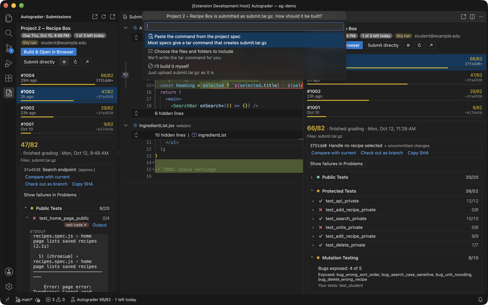
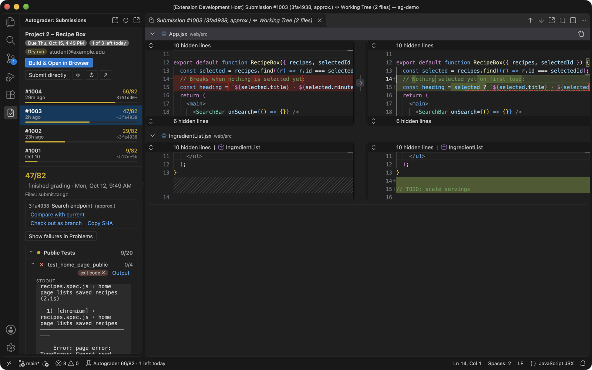

<div align="center">

# Autograder.io for VS Code

**Submit, read results, and jump straight to the failing line, without leaving your editor.**

Built for University of Michigan CS students.<br>
Works with any project on [autograder.io](https://autograder.io).

[](LICENSE)




</div>

---

## Why

Grading feedback from autograder.io lives in a browser tab, far from your code :(
This extension brings autograder.io into VS Code, so you can easily compare submissions and feedback side-by-side with your project:

| | |
|---|---|
| **Results sidebar** | Every submission with its score. Each test suite and test is expandable, with output loaded on demand. |
| **Clickable line numbers** | `file.py:42`, Python tracebacks, gcc/clang errors and valgrind frames become links. **Minified `bundle.js` frames are source-mapped back to your `.jsx`.** |
| **Failures in the Problems panel** | One click turns every failing test's file references into red squiggles in your code. |
| **Tarball-aware submitting** | For classes that expect a tarball instead of individual files, paste the spec's `tar` command once, or pick the files to include. After that, building the submission is one click. |
| **Git time travel** | Each submission is tied to the exact code that produced it. Diff any submission against your current code, revert changes, or check it out as a branch. |

> [!NOTE]
> This is a student project not affiliated with the University of Michigan or the autograder.io team.

## Features

### Link results to your code

Click any file reference in test output to open that line.

- **Sandbox paths are mapped to your workspace.** The autograder runs your code under `/home/autograder/working_dir/submit/…`, and those paths are mapped back to the matching files in your workspace.
- **Bundled JavaScript gets source-mapped.** For web projects with a bundled front end (React, webpack, esbuild…), frames in the compiled `bundle.js` are mapped back to your source using the `bundle.js.map` *from the tarball you actually submitted*, downloaded from autograder.io. Rebuilding locally afterwards doesn't break the mapping.
- **Library frames stay unlinked.** Frames inside React or other libraries aren't linked, so only your code is.

**Show failures in Problems** reads the output of every failing test you're allowed to see and adds an entry for each file reference. Each entry is labeled with the test name and the real error message.

### Submit in one click

The extension asks autograder.io which files your project expects. The first time you build, it sets itself up from that:

- **Individual files** (e.g. `project.cpp`, `tests.cpp`): the matching files in your folder are pre-selected for you to confirm.
- **A tarball** (e.g. `submit.tar.gz`): you choose one of these.
  - Paste the `tar` command from the project spec.
  - Pick the files and folders to include. If you already have a tarball, its contents are pre-checked, and the extension writes the command.
  - Run your own script.



Then pick how you submit (the `autograder.submitMethod` setting):

| | What happens |
|---|---|
| **Build & Open in Browser** *(default)* | Builds the submission and checks it against what autograder.io expects. Then opens the project page and shows the file in Finder/Explorer so you can upload it. **Nothing is uploaded from VS Code.** The extension watches for your upload and shows the score when grading finishes. |
| **Submit directly** | Builds and uploads from VS Code. First, a confirmation lists the files with their sizes and modification times, how many submissions you've used today, and the honor pledge. |

### Every submission, tied to its code

When you build a submission, the extension saves a snapshot commit of your working tree. The snapshot includes uncommitted and untracked (non-ignored) files. **Your branch, index and stash are never touched.**

- **Direct submits** are linked to their snapshot immediately.
- **Website uploads** are linked when the uploaded file's SHA-256 matches a build. The link is exact even if you built several times before uploading.
- **Older submissions**, made before you installed the extension, show the last commit before the submission time, marked `~approx`.

From any submission you can **Compare with current** (a multi-file diff), **Check out as branch**, or **Copy SHA**.



## Install

**[⬇ Download autograder-io-vscode.vsix](https://github.com/jasnzhng/autograder-vscode/releases/latest/download/autograder-io-vscode.vsix)** (latest release), then install it with either:

- **VS Code:** open the Extensions view, click **⋯ → Install from VSIX…**, and pick the downloaded file, or
- **Terminal:**
  ```bash
  code --install-extension ~/Downloads/autograder-io-vscode.vsix
  ```

All versions are on the [Releases page](https://github.com/jasnzhng/autograder-vscode/releases).

<details>
<summary>Build from source instead</summary>

Requires Node 20+.

```bash
git clone https://github.com/jasnzhng/autograder-vscode.git
cd autograder-vscode
npm install
npm run package          # creates autograder-io-vscode-<version>.vsix
code --install-extension autograder-io-vscode-*.vsix
```
</details>

## Getting started

1. **Sign in.** Run **Autograder: Sign In** from the Command Palette (`⇧⌘P` / `Ctrl+Shift+P`).
   - It opens `https://autograder.io/web/__apitoken__`.
   - Copy the token shown there and paste it into VS Code.
   - The token is stored in VS Code's SecretStorage, i.e. your OS keychain.
   - [Why a token?](docs/how-it-works.md#signing-in)
2. **Open your project folder.**
   - The extension looks for an `autograder.io/web/project/<id>` link in your scripts and READMEs.
   - If it doesn't find one, it asks you to choose the course and project.
3. **Open the Autograder view.** Click the Autograder icon in the activity bar or the status bar item, or run **Autograder: Show Results**. Need more room? The pop-out button in the view's title bar opens it as an editor tab.
4. **Set up submitting** when asked, then use **Build & Open in Browser**.

## Commands

| Command | |
|---|---|
| `Autograder: Show Results` | Open the Autograder sidebar for the current project. |
| `Autograder: Open Results in Editor Area` | The same view as a wide editor tab. |
| `Autograder: Refresh` | Reload submissions and results. |
| `Autograder: Build Submission & Open in Browser` | Build, check, open autograder.io, reveal the file. |
| `Autograder: Submit Project` | Build and upload directly. |
| `Autograder: Configure Submission Files…` | Redo the first-run setup. |
| `Autograder: Select Project for This Workspace` | Choose a different course/project. |
| `Autograder: Open Project on autograder.io` | |
| `Autograder: Clear Autograder Problems` | Remove the diagnostics added by "Show failures in Problems". |
| `Autograder: Sign In` / `Sign Out` | |

## Settings

| Setting | Default | |
|---|---|---|
| `autograder.projectId` | auto | Project ID, the number in `autograder.io/web/project/<id>`. |
| `autograder.submitMethod` | `browser` | `browser`: build and open the website. `upload`: submit directly. |
| `autograder.buildCommand` | *asked* | Shell command run in the workspace root before each build, e.g. the spec's `tar -czvf submit.tar.gz …`. Empty string = no build step. |
| `autograder.submitFiles` | `[]` | Paths or globs to upload. When empty, files are matched against the project's expected patterns. |
| `autograder.snapshotCommits` | `true` | Record git snapshots at build time. |
| `autograder.dryRun` | `false`¹ | Do everything except upload. |
| `autograder.baseUrl` | `https://autograder.io` | |

¹ When unset, defaults to **on** in an Extension Development Host (F5), so trying a dev build can never use up a submission.

## Privacy & safety

- **Your token stays on your machine.** It's kept in the OS keychain and sent only to autograder.io.
- **Signing out only forgets the token locally.** autograder.io keeps one token per user, shared with your browser session. Revoking it on the website would also log you out there.
- **Reading is read-only.** Viewing results, output and submitted files only ever uses `GET` requests.
- **Uploading takes an explicit choice.** It happens only through **Submit directly**, after a confirmation dialog. The default flow never uploads.
- **Snapshots are local.** They're ordinary git objects under `refs/autograder/*` in your repo. They aren't pushed unless you push those refs yourself.

## FAQ

<details>
<summary><b>Is this allowed in my course?</b></summary>

The extension uses autograder.io's own API, with the personal token the site gives every user. That's the same mechanism the official CLI tools use. Uploading directly is equivalent to clicking Submit on the website, and the server applies the same daily limits. That said, **check your course's policies**. If in doubt, use the default **Build & Open in Browser** flow, which leaves the upload to you.
</details>

<details>
<summary><b>Why not just embed the autograder.io website?</b></summary>

autograder.io signs in with Google, and Google's login pages refuse to load inside embedded frames. So an embedded copy of the site could never be logged in. Instead, the extension renders the same data through the site's REST API. See [how it works](docs/how-it-works.md).
</details>

<details>
<summary><b>The jump went to the wrong line.</b></summary>

Line numbers come from the code you *submitted*. If you've edited the file since, the line may have moved. Use **Compare with current** on that submission to see what changed.
</details>

<details>
<summary><b>Does it work for C++ / Python / assembly projects?</b></summary>

Yes. It recognizes gcc/clang (`file.cpp:12:5:`), valgrind (`(file.cpp:42)`), pytest (`file.py:23:`), Python tracebacks, Node and browser stacks, and `file(42)`-style references.
</details>

## Documentation

- [How it works](docs/how-it-works.md): signing in, link resolution and source maps, snapshots, matching uploads made on the website.
- [autograder.io API notes](docs/autograder-api.md): the endpoints the extension uses, verified against the server source.
- [Development](docs/development.md): building, testing, and the offline demo kit used for the screenshots above.

## License

[MIT](LICENSE)
